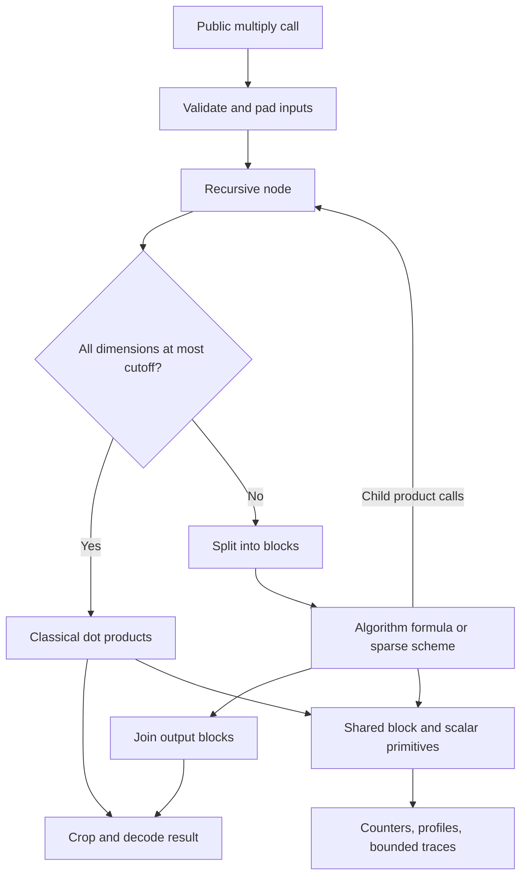

# Reading the reference implementation

The project has two related jobs. One is to execute a known matrix multiplication
algorithm and observe every arithmetic primitive. The other is to construct new
finite identities and check whether they can become matrix multiplication
algorithms. Construction work and multiplier work have different meanings, so
they deliberately have separate code and evidence.

## Start with an actual multiplication

Read `matrix_multiplication/naive.py`, then `strassen.py` and
`strassen_winograd.py`. Each public function has the same interface. A `step`
function describes the formula at one level; its `product` argument supplies a
child multiplication. The formula chooses the child-product count. Traversal
chooses the shapes and stopping condition.

Continue with `common.py`, which owns input validation, padding, copying,
recursion, splitting, joining, and cropping. Its elementwise block operations call
`scalars.py`, where field operations become observable component operations.
`instrumentation.py` observes that execution using a context-local observer.

For example, Strassen multiplying two 4×4 matrices with cutoff 1 makes seven
2×2 child calls. Each makes seven 1×1 leaf calls, so 49 data multiplications occur.
With cutoff 2, those seven children instead use the classical loop, which needs
eight multiplications per child: 56 total. Additions are counted separately,
including each classical product's accumulation into the running sum.

Padding and cutoffs explain why a finite graph has steps and plateaus rather than
following one smooth power law. They do not change the family's asymptotic
exponent when the cutoff remains fixed as inputs grow.

## Follow coefficients through execution and checking

`schemes.py` describes a bilinear recipe using three sparse tables:

- **U / left:** coefficients combining left input blocks for each child product.
- **V / right:** coefficients combining right input blocks for that product.
- **W / output:** coefficients distributing its result to output blocks.

Each table has one column per product. A term `(index, coefficient)` selects a
row-major block and scales it. A common divisor, if present, normalizes the output
once per node. The generic evaluator performs the literal scale/add schedule,
including unit coefficients, so its operation count can be predicted exactly.

`scheme_io.py` reads data without executing imported code. It checks the complete
identity with exact rational complex pairs. Sparse expansion adds every
`U_i,t * V_j,t * W_k,t` contribution, including cancellations, then compares the
result with the matrix multiplication tensor. Both unexpected nonzeros and
missing required entries are errors.

`composition.py` selects square stages by depth. `rectangular.py` handles balanced
rectangular cycles and the trace-symmetry rotation used by `smirnov.py`. Each
stage has a fixed product count. Multiplying the cycle's product counts and
dimension contractions gives its repeating recurrence without storing a gigantic
combined coefficient tensor.

`certificates.py` extracts the maintained Strassen formulas symbolically and
exports portable evidence. `certificate_checker.py` intentionally stays separate:
it imports only the standard library and evaluates every matrix-unit input pair.
The two checks share the mathematical specification, but use different evaluation
procedures. Neither claims to prove the Python interpreter or universal
floating-point accuracy.

## Separate observations from predictions

`verification.py` computes an independent classical answer with `Fraction`
arithmetic. Rational inputs require exact equality. Floating inputs are compared
with an explicitly recorded tolerance against their exact binary-input answer.
Verification does not use the observed scalar primitives.

`work_sweep.py` executes requested sizes and cutoffs with counters enabled and
primitive clocks disabled. Its predictions independently count the declared
recursion schedule. Its fitted slopes describe the finite observed range; they
do not prove an asymptotic exponent. Equivalent cutoffs can reuse a measurement
only when the known traversal has identical padding, ordered stages, and leaves.
Every reused row records its source cutoff.

`experiments.py` supplies optional elapsed-time and Python-allocation diagnostics.
Those are secondary to the arithmetic objective. `reporting.py` renders original
JSON evidence as offline HTML and SVG, labels both axes, and keeps predictions,
observations, and earlier diagnostic pairs distinct.

## Read the construction machinery next

`tensors.py` represents a sum of rational rank-one terms. Its `rank` property is
the number of terms in that particular decomposition, an upper bound on minimum
rank. A generic tensor is not necessarily matrix multiplication. `to_scheme`
must check that identity before it enters a multiplier.

The module supplies tensor products, powers, direct sums, and linear restrictions.
`matrix_product` additionally permutes paired coordinates into matrix row-major
order. That permutation is essential: pairing two flattened matrices does not
automatically group the new rows before the new columns.

`decomposition_search.py` searches exact algebraic transformations. Flips preserve
a tensor by cancelling two cross terms. Reductions use a verified dependence
between two-factor columns to remove a product. Optional splits temporarily
increase rank. Each accepted move can be replayed without rerunning randomness;
the final recipe is checked completely. Bounded unsuccessful walks establish no
impossibility result.

`degenerations.py` builds the published CW polynomial family independently and
uses exact interpolation to recover its leading tensor coefficient. Recovery
explicitly pays its finite product cost. A smaller border-rank bound is a
different mathematical statement and is not labelled an executable multiplier.

`cw_extraction.py` turns the six sector types into row/inner/column index rules.
Read `component` for the coordinate permutation, then `selection_conflicts` for
the independence check. Distinct variable groups can still leave an unintended
cross-sector; checking just pairwise disjointness would be incorrect. `extract_cw`
compares the entire literal restriction and finite polynomial recovery against
independently constructed classical products, then checks actual rational calls.
Its report keeps the greedy selection, explicit maps, and paid finite cost.

`tensor_execution.py` is a reusable execution primitive for arbitrary rational
bilinear recipes, including unit-size axes and direct sums. It evaluates sparse
input combinations, multiplies them, and accumulates weighted output entries via
`scalars.py`. It always counts fixed scaling, even by one, and every surviving
data product, even on zero inputs. This simple schedule is explicitly labelled
in reports, so it is not confused with the optimized matrix-scheme schedule.
`tensors.coefficient_expansion` recovers sparse polynomial coefficient planes
without evaluations. `optimize_cw_extraction` compares this with interpolation,
reduces exact two-factor dependencies, replays them, and checks the full identity.
The classical target is a verifier specification, not a substituted algorithm.
`optimize_recovery` shares the coefficient expansion and replay checks between
fine and coarse restrictions; it does not need to know a component's shape.

`cw_coarsening.py` merges fine words by their summed group index. Start with
`weight_groups` for the coordinate partition and `coarse_catalog` for its
complete reconstruction check. The catalog is not an independent direct sum:
many entries share spaces. Each entry retains exact coefficient support, including
components that `tensor_classification.py` cannot recognize as matrix products.
That classifier derives integer matrix dimensions, builds support neighborhoods,
recovers explicit entry permutations, then checks every tensor coefficient.
Its failure labels distinguish a full-space dimension obstruction from a limited
basis-permutation test. General linear isomorphism is not searched.
`choose_coarse_components` admits only proved layouts, checking shared spaces and
unintended weight triples. `extract_coarse_cw` verifies the resulting independent
sum against both literal coefficients and recovered polynomial coefficients.

In `dense_packing.py`, start with `packing_schedule`, then `verify_schedule`.
The planner partitions (row,inner,column) triples into rectangular component
tiles. The verifier independently counts multiplicities, detecting holes and
duplicate inner contributions. `batch_maps` connects slots to the dense inputs
and adds outputs; `pack_tensor` applies those maps, replays any new dependencies,
and checks every matrix tensor coefficient. Batches are added in shared spaces,
not combined using `direct_sum`, which would give separate outputs.
`pack_coarse_cw` and `pack_cw` use the same packing and
`packed_execution_evidence` primitives, so their data-product counts and exact
rational calls are checked on equal terms. Catalog construction is setup work.
The exported recipe recurses through the existing scheme engine without runtime
search or tensor expansion. See `CONSTRUCTIONS.md` for commands and the stronger
large-power extraction/conversion that remains research work.

`constructions.py` exposes these operations through one shared typed request API
and a CLI. `research_suite.py` orchestrates that API, certificates, diagnostics,
and the size sweep. Candidate integration is a separate checked stage: an exact
identity must also have a supported repeating execution plan. Stage failures
retain diagnostics, successful artifacts, and a nonzero final status.

## Add an algorithm without duplicating the machinery

For operand-size observation, read `operand_costs.py` from `exact_parts` through
`word_cost` and `OperandCosts.observe`. It is called after atomic execution by
`instrumentation.evaluate`; it never chooses arithmetic results. Rational word
costs and excluded GCD/division work are documented beside their expressions.
`trace_value` protects enormous exact values from decimal trace-rendering limits.

For non-executed growth, read `scaling.stage_counts`, `category_budget`, then
`project_work`. Known formulas keep separate addition/subtraction counts; sparse
descriptors use their three matrix areas. Recurrence category sums must equal the
existing independent total budget. `work_sweep` compares them with observed
primitives and keeps projections separate from measurements. Optional memory
probes surround public calls, while the suite's setup probes have separate scopes.
`reporting.resource_scaling_sections` preserves those distinctions in the charts.

`size_effects.py` separates recorded stage divisions from zero-padding and cutoff
choices. `describe_sample` reads the exact discrete geometry, including rectangular
prefixes and padding-before-cutoff behavior. `describe_transition` compares adjacent
sampled geometries, recording observed field-count equality separately. Unknown
callbacks receive declared-model evidence, not a claimed reference traversal.
`reporting.size_effects_section` puts these paths and caveats beside each graph.

For an explicit formula, supply a block `step` using shared arithmetic and the
provided child-product callback. For a coefficient recipe, supply exact U/V/W
data and verify it before execution. Define its independent operation budget and
test complete base identities, recursive products, numeric domains, padding, and
agreement between predicted and observed work. Preserve source attribution and
license notices in data and references.

Keep new construction algorithms separate from execution primitives. Explain
index conventions and cancellation arguments near the code that uses them.
Extend exact checking before introducing new coefficient fields. Use small
regressions for development; larger research runs belong in dated ignored output
directories, with their settings and provenance recorded.
