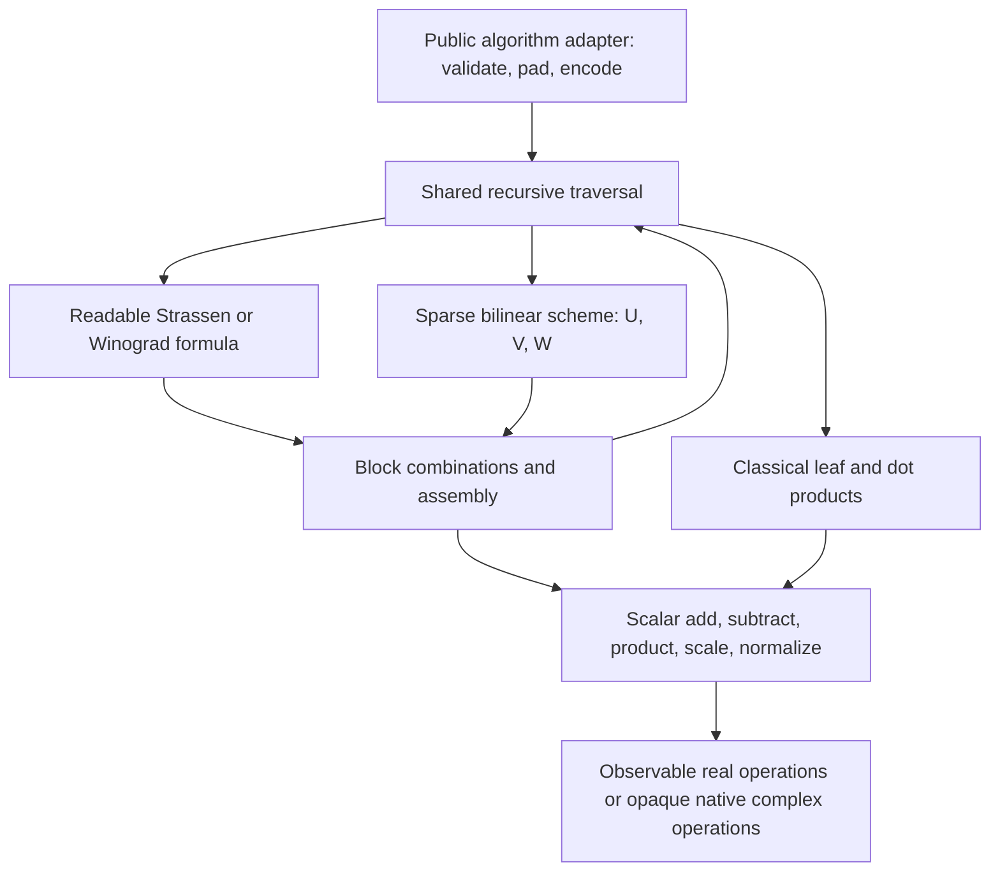

# Observable reference implementations

Readability, instrumentability, and reasoning take precedence over execution
speed. The formulas retain their product counts and mathematical arithmetic
exponents. The current implementation remains standard-library Python; no
external matrix multiplication implementation is used.

## Primitive hierarchy and flow



| Layer | Source | Responsibility |
| --- | --- | --- |
| Observation | `matrix_multiplication/instrumentation.py` | Context-local counters, profiles, parent-ID traces, bounded retention |
| Scalars | `matrix_multiplication/scalars.py` | Field operations, coefficient scaling, exact Gaussian pairs, normalization |
| Vectors and blocks | `matrix_multiplication/common.py` | Dot products, elementwise loops, sparse linear combinations, split/join, pad/crop |
| Traversal | `recursive_kernel` and `recursive_product` in `common.py` | Leaf selection, child callbacks, recursion depth, common public flow |
| Schemes | `matrix_multiplication/schemes.py` | Sparse recipe descriptor, structural validation, U/V products and W accumulation |
| Rectangular cycle | `matrix_multiplication/rectangular.py` | Smirnov-required cyclic orientation, balanced dimension checks, distinct block-area budgets; shared traversal and primitives |
| Formulas/adapters | Existing algorithm modules | Algorithm-specific algebra and scalar-domain setup |
| Correctness | `matrix_multiplication/verification.py` | Independent exact oracle; deliberately does not use the observed arithmetic |

Block primitives assume conformable validated internal blocks. The public
adapters validate external inputs. Strassen's `step` names its seven products;
Winograd's `step` explicitly preserves reused intermediates. Both give output
blocks to the same traversal. AlphaEvolve translates its transposed W convention
once into the generic sparse scheme descriptor, then uses that traversal too.

## What counts mean

`Composition` selects a stage by recursion depth through the same traversal.
Its cycle repeats, and padding uses a product of successive stage radices.
`plan.budget(rows, inner, columns, cutoff=...)` predicts products and total field
and atomic work independently of execution. Imported schemes count every scale
and accumulation, including coefficients equal to zero or one. Built-in Strassen
and Winograd stages preserve their readable formulas and reused intermediates.
Complex-coefficient plans encode every stage's input as Gaussian pairs, so even
real-coefficient stages incur component arithmetic; the budget includes that cost.
Import and exact identity verification are setup work outside the counters.
Certificate generation and both exact identity checkers are also outside the
measured execution. The independent checker imports no observation primitives;
built-in formula extraction explicitly suspends any active observer. Certificates
establish the mathematical recipe, not the accuracy of operation counters.
Reports expose each level's stage and dimensions, the cycle recurrence, and budget
matches. The mixed schedule's asymptotic exponent is not a slope measured from a
single experiment. See README's import/composition section for the JSON contract.

An observer records **the operations actually executed by this reference
schedule**, including work on padding and multiplication/addition by zero or one.
It does not silently skip arithmetic based on input values.

| Counter family | Meaning |
| --- | --- |
| `field_multiplications` | Products of two data-dependent field values in leaf kernels |
| `coefficient_multiplications` | Fixed coefficient times a field value; separate from bilinear rank |
| `field_additions`, `field_subtractions` | Semantic field operations used for block combinations and dot accumulation |
| `field_normalizations` | Output values divided by a common scheme scale |
| `real_*` | Exposed component operations over real integers, Fractions, or floats |
| `native_complex_*` | Calls to built-in complex operators; their internal implementation is opaque |
| `integer_divmods` | Exact integer normalization calls returning quotient and remainder |
| `recursive_nodes`, `classical_leaves` | Traversal structure and classical termination |
| `input_cells`, `padded_input_cells` | Requested input size and the padded recursive representation |
| `matrix_cells_*`, `vector_cells_*` | Cumulative logical cells allocated/copied by the named data primitives |

The field and atomic layers describe the same calculation at different levels:
**do not add their totals together**. `atomic_arithmetic_operations` includes
only `real_*`, `native_complex_*`, and `integer_divmods`. It is a unit-cost
arithmetic-call count, not a CPU instruction count or a FLOP counter. Fraction
operators, integer bit operations, and native complex internals are not expanded.
Index calculations, loop control, validation comparisons, representation changes,
and observation machinery are outside the numerical arithmetic budget.

`field_arithmetic_operations` sums data products, coefficient scaling, field
additions/subtractions, and normalizations at the semantic field layer. It is a
separate total from atomic/component work. New snapshots explicitly state that
omitted arithmetic counter categories have zero observed calls. Older reports
without that convention continue to display absent values as unavailable.

## Executed work versus theoretical growth

`python sweep.py` runs multiple requested matrix dimensions and leaf cutoffs,
collects work with `profile=False`, and verifies outputs independently. Its
JSON and HTML report are generated together automatically through the shared
`matrix_multiplication.reporting` library. `explore.py --report path.json` likewise
generates HTML automatically after saving that JSON; no separate rendering script
is needed. Both commands accept `--output-root` for the dated output directories.
The sweep retains readable per-sample counters, primitive profiles, exact
verification, and recursion-depth charts. Optional `--reference-report path.json`
embeds an earlier pair experiment, preserving its original JSON and distinguishing
its secondary measurements from the sweep. The sweep's main report plots executed
counts, not elapsed seconds. Solid points are observed
data multiplications; dashed curves use the declared recurrence without padding;
crosses predict the recurrence after padding and classical leaf selection.
For a recursive scheme with base size u, r products, and effective leaf size b,
the smooth data-product curve for n >= b is `b^3 * (n/b)^log_u(r)`.
The padded prediction is `r^levels * leaf_size^3`. Actual execution counters
remain separate and are checked against that prediction.

Total-step comparisons also predict the quadratic non-product work. At padded
dimension s, leaf size b, and L recursion levels, each layer's recurrence is
`leaf_factor * r^L * b^3 + block_factor * sum(r^i * (s/u^(i+1))^2, i=0..L-1)`.
The smooth curve continuously extends that geometric sum without padding. These
constants are declared from the primitive formulas, never fitted to measured
counters. The JSON stores the costs and independently checks both layer totals.
For real integer classical leaves the factor is 2 (multiply plus accumulation);
Gaussian leaves have field factor 2 and component factor 8. Strassen's block
factor is 18 and Winograd's is 15. For AlphaEvolve's K nonzero coefficients, the
field block factor is `2*K+16` and component factor is `8*K+32`, including output
normalization. This model describes the current reference schedule, not hardware
instructions or arbitrary-precision bit complexity.

Finite-range slopes are least-squares fits of `log(count)` against `log(n)`.
They are useful observations, not discovered or proven asymptotic exponents.
Raw sampled counts, fit ranges, and R-squared remain in JSON. Classical leaf
size, zero-padding plateaus, coefficient arithmetic, and lower-order terms can
all affect a short-range fit. Integers and complex pairs still use the documented
unit-cost scalar counting conventions; arbitrary-precision bit costs are separate.

`Gaussian` exposes one complex product as four real products, one real
subtraction, and one real addition. A complex addition exposes two real additions.
The reference deliberately does not optimize constant coefficient multiplications.
Integer normalization uses checked exact divmod; Fraction/float normalization
uses division. Native complex inputs to non-AlphaEvolve formulas remain built-in
complex values to preserve their earlier evaluation behavior; the report labels
that work as opaque rather than estimating internal real costs.

Cell counters are not bytes, peak live memory, allocator activity, or scalar
object allocations. They distinguish explicit matrix/vector copying from numerical
work. Measuring actual process/GPU memory will require a separate backend probe.

## Independently checked operation budgets

With square 2-by-2 inputs and cutoff 1:

| Algorithm | Data products | Field additions | Field subtractions |
| --- | --- | --- | --- |
| Naive | 8 | 8 | 0 |
| Strassen | 7 | 19 | 6 |
| Strassen-Winograd | 7 | 14 | 8 |

Dots accumulate from zero, so each length-k dot uses k additions, rather than
starting with the first product and counting k-1. Strassen's 19 additions include
7 leaf additions plus 12 block additions. Winograd's 14 include 7 leaf additions
plus 7 block additions. Their block operation budgets remain 18 and 15.

All classical leaves now use that explicit accumulation schedule. Some Python
versions optimize built-in `sum` with floating compensation; the former recursive
leaf used `sum`. Floating leaf results can therefore differ in their last bits
from that earlier code. Exact results and mathematical identities are unchanged;
the independent exact oracle checks floating accuracy separately.

With 4-by-4 AlphaEvolve inputs and cutoff 1, let K be the number of nonzero
coefficients across U, V, and W. The schedule uses 48 data field products, K
coefficient field products, 4*(48+K) real products, and 16 field normalizations.
For exact integer inputs the normalizations execute 32 integer divmod calls.
The tests check these budgets against actual observation, as well as 7^2 and
48^2 data products at two recursion levels. Increasing the classical leaf cutoff
changes the measured finite work, so record the cutoff alongside experiment data.

## API and streaming observation

```python
from matrix_multiplication import Instrumentation, multiply

measurement = Instrumentation(profile=True, trace=True, trace_limit=1000,
                              capture_values=False)
answer = multiply(a, b, algorithm="strassen", cutoff=1,
                  instrumentation=measurement)
report = measurement.snapshot()  # JSON-compatible counters and primitive profiles
events = measurement.events      # retained prefix, with explicit dropped count
```

A fresh observer describes a fresh experiment. Reusing it aggregates results.
Standalone primitive experiments can activate the same mechanism explicitly:

```python
from matrix_multiplication import scalars
from matrix_multiplication.instrumentation import session

with session(measurement):
    value = scalars.multiply(2, 3)
```

For a complete trace, supply `sink=handle_event`. The sink receives every event,
while `trace=False` retains none in the observer. A handler can write JSON lines
to disk. Observer callbacks run with observation suspended so their own arithmetic
cannot contaminate the algorithm or cause recursive tracing. Sink execution still
contributes to instrumented wall time. A single observer is not designed to be
shared among concurrently executing workers.

Events are `enter`, `arithmetic`, or `exit`, with a monotonically increasing
sequence. Scope enters carry a span ID and parent ID; arithmetic events carry
their parent span, category, recursion depth, role, status, and duration. Exits
carry inclusive counts, duration, and success/error status. Optional scalar
operand/result representations use strings, preserving exact values and making
complex pairs JSON-safe. Bounded retained traces can end mid-scope; use their
dropped-event count or a streaming sink when a complete hierarchy is required.

## Profiles and asymptotic preservation

Each primitive profile contains calls, inclusive/exclusive seconds, and inclusive
counter deltas. Inclusive profiles overlap: summing parent and child time or
counts double-counts work. Atomic timings measure operator calls; scope timings
include Python traversal and observation overhead. These are wall-clock reference
profiles, not isolated kernel timings or predictions of an optimized implementation.
`profile=False` disables clocks while retaining counts and optional traces.

Default aggregation performs bounded work per operation/scope, stores aggregates
by fixed primitive name, and retains only O(recursion depth) depth counters/active
frames. It does not copy stack paths or propagate each operation to all ancestors.
Consequently it preserves the unit-cost arithmetic exponents of the algorithms.
Full tracing writes one constant-size record per event (unless optional value
representations grow); it may require memory/disk proportional to executed work.
User-defined sinks and arbitrary-precision bit costs have their own costs.

AlphaEvolve data loading, sparse factor compilation, and complete tensor
verification are setup separate from scalar product counts. Identity verification
and the independent result oracle do not enter those counters. Sparse descriptor
assembly within the adapter can contribute to adapter wall time; cold coefficient
loading and verification occur before the measured product scope.

## Explorer and source documentation checks

Mathematical efficiency is the primary research objective. Each explorer report
has a `mathematical_model`: the formula-derived square exponent, base rank and
dimension, recurrence, arithmetic domain, and assumptions. It describes growing
square inputs with a fixed leaf cutoff. It is not a fitted exponent from a single
run, a statement about arbitrary rectangular shapes, or a floating-point error
guarantee. Fixed recursion depth with growing classical leaves is still cubic.

`execution_measurements` contains separate secondary diagnostics:

| Measurement | Scope |
| --- | --- |
| `elapsed_algorithm_call_seconds` | Public algorithm call, including validation, padding, cold setup and observation; excludes the oracle and report writing |
| `accuracy` | Exact-oracle comparison, equality/tolerance mode, maximum display error and failed entries |
| `classical_equivalent_field_operations_per_second` | Conventional `2*M*N*K` divided by call time, not actual work or physical FLOP/s |
| `python_traced_peak_bytes` | Opt-in traced Python allocations during the call, including observation and setup; excludes pre-existing inputs and untraced native memory |
| Process/GPU peaks, hardware memory traffic, instruction counts | Explicitly unmeasured; future backend probes must collect these rather than infer them from logical cells |

`--counts-only` preserves arithmetic counts and disables per-primitive clocks;
the whole-call timer remains independent. `--measure-memory` enables standard-
library tracemalloc for each call. It changes measured execution overhead, not
the algorithm's arithmetic decisions. Cold and warm allocation peaks can differ.
An existing tracer is left untouched and the memory measurement is labelled
unavailable; its historical peak is never passed off as this call's peak.
Nonfinite display errors are encoded as strings, not invalid JSON numbers. Errors
still export elapsed attempted-call measurements, with unavailable accuracy when
verification did not complete. Exact comparison is independent of the display
error's floating representation.

```
python explore.py --algorithm all --instrument
python explore.py --algorithm strassen --report experiment.json
python explore.py --algorithm all --counts-only --measure-memory --report experiment.json
python explore.py --algorithm alphaevolve --trace trace.json --trace-limit 1000 --trace-values
python -m unittest discover -s tests -v
python tools/check_documentation.py
```

The explorer gives each algorithm a new observer and verifies its result after
the measured computation. Reports include algorithm, cutoff, tolerances, input
shapes, unpadded classical product baseline, and a hash of the input Python
representations (rather than the inputs themselves). Report JSON stores the profiles and pass/fail status;
trace JSON stores those reports plus retained events. Documentation checking
requires headers and class/function docstrings in the maintained Python sources,
including tests and tools. Third-party research snapshots are excluded.

`session(None)` inherits an enclosing observer; recursive primitives use that
behavior to participate in one experiment. `suspended()` explicitly disables
observation for setup or observer callbacks and restores the prior context on
success or failure. Symbolic certificate extraction uses suspension, so building
a formula inside an active experiment cannot add setup work to its counters.

## Construction and search evidence

`python sweep.py` now runs all implemented report families in one dated output
tree. Its arithmetic-growth stage keeps clocks and allocation probes disabled.
Separate 2-by-2 integer and floating-point diagnostic pairs enable primitive
profiles, Python allocation peaks, and bounded scalar/primitive traces. Those
pair envelopes remain in their original JSON and are embedded as separately
scoped references, never assigned to the larger size-sweep samples. Generated
matrix recipes join the arithmetic comparison automatically. `--measurements-only`
skips construction/diagnostic stages while retaining growth measurements.

`suite-manifest.json` records stage outcomes, requested budgets, source and
artifact fingerprints. A failed identity/execution/budget check causes a failed
suite and nonzero CLI status; a bounded search that does not find its target
remains valid research evidence and explicitly records the miss. The suite
checkpoints completed stages, but does not yet resume an interrupted random walk.

The exact tensor generator and search engine perform setup arithmetic on
coefficients. Their restarts, attempted/accepted flips and splits, height
rejections, and replayable best path are recorded separately in construction
reports. We do not currently count every rational operation of the generator.
These counts are not matrix multiplication execution measurements.

An exported, fully verified `scheme.json` enters the existing composition engine.
Its input combinations, recursive products, output accumulations, coefficient
scalings, and any normalizations use the same instrumented execution primitives
and per-level budgets as imported schemes. The measurement sweep can therefore
compare a discovered recipe against existing algorithms without changing its
meaning of products or arithmetic steps. See [CONSTRUCTIONS.md](CONSTRUCTIONS.md).

CW polynomial recovery reports both its polynomial rank-one term count and the
finite products required by exact interpolation. That is construction evidence
for a generic tensor, not a measured square multiplier with the CW limiting
exponent. Extraction and conversion to a verified matrix identity must precede
such an execution claim.

CW packing now compares that interpolation recipe with direct coefficient
expansion and replayed dependency reductions. The reports retain each finite
product count separately. Finite tiling compiles input/output maps into a dense
recipe and replays additional mapped dependencies. Executing the resulting
recipe pays every surviving data product and all coefficient/addition work;
construction, tensor checks, and replay are setup and are not mixed into those
measurements. The generic tensor kernel deliberately counts scaling by one.
After export, the existing composition engine uses its documented coefficient
shortcuts and independently checked budget. Each observation names its kernel.
These small dense recipes currently have cubic exponents; no limiting CW/ASI
bound is assigned to them.

The automatic coarse CW experiment merges fine group words by summed weights,
records every component's exact coefficients and classification witness, and
verifies reconstruction of the full source tensor. Classification is setup;
it does not count as matrix execution or imply a lower exponent. Only proved
matrix components enter its induced sum and finite packing. Their actual
direct-sum and dense calls use the same observable primitives as fine extraction.
The reports retain interpolation, expansion, reduction and packing costs, plus
unrecognized components that need further research. The selected best fine/coarse
dense base joins arithmetic growth and certificates; every catalog is retained.

## Exact operand costs and recurrence projections

`Instrumentation` now observes atomic operands/results with `operand_costs.py`.
It records magnitude bit widths, denominator growth, bounded word-width buckets,
and declared schoolbook word costs by data/coefficient/combination role and atomic
primitive. It never replaces integers, Fraction arithmetic or Gaussian pairs.
Huge traced values use explicitly labelled bit summaries when decimal rendering
would be excessive; the stored number is unchanged.

The baseline is 64 bits per magnitude word. Integer multiplication models the
product of the two word counts. Rational multiplication models numerator and
denominator products; rational addition/subtraction models cross-products and
the numerator sum. Unit denominators are copied. These unreduced expressions
do not model Fraction's GCD, cross-cancellation, division, sign or carry handling.
The estimate is neither Python's integer algorithm nor hardware instruction work.
Unsupported floating/native-complex/division calls remain explicit, with partial
coverage rather than invented costs. Do not add word estimates to field counts:
they describe different levels of the same execution.

Growth calls additionally use `ExecutionMeasurement` for a fresh optional Python
allocation peak, including observation and any cold setup but excluding existing
inputs, the oracle and untraced native/GPU storage. `--no-sweep-memory` disables
this probe. Reused cutoff evidence includes its original resource scope. Suite
setup stages have separate time/allocation scopes including generation, checking
and artifact writing. Individual raw coefficient setup operations are not counted.

`scaling.py` derives category budgets from formula schedules and sparse descriptor
areas. Categories must match both the independent total budget and actual calls.
`--projection-cycles` evaluates those recurrences at whole-cycle sizes without
matrix execution. Projections and measured points have separate report fields;
the symbolic recurrence, not a finite graph, describes asymptotic growth. Operand
width and peak-memory projections are not derived. Three-array hypothetical
64-bit storage is a comparison baseline, not actual Fraction or algorithm storage.

For a concrete interpretation, Strassen with cutoff one and n=2^h performs 7^h
data products. Its recursive combination area sum is (7^h-4^h)/3. Our schedule
therefore has 6*(7^h-4^h)/3 subtractions and
7^h+12*(7^h-4^h)/3 additions, including classical leaf accumulation from zero.
The n² term is lower order, but additions/subtractions also have leading growth
n^log_2(7); they are not merely a fixed startup penalty. Winograd changes their
constants while retaining seven child products. The schoolbook baseline counts
n³ products and n³ accumulations in our deliberately literal schedule. A stored
finite recipe's preparation can be fixed relative to matrix n, while exploring
larger construction powers or search budgets incurs separate growing setup work.

## Explaining discrete graph steps

Each sweep sample now saves `size_effects`: requested/padded dimensions, extra
zero input cells, a rational padded-volume ratio (not a data-product overhead
ratio), all stage/child dimensions, leaf dimensions and cutoff ordering. The
recursion's prescribed block counts are mathematical. Whole-input padding to a
covering schedule prefix and the classical cutoff are portable interpreter
choices. Neither is attributed to GPU width, Python or limited home resources.

At natural Strassen sizes 2^h with cutoff one, data products are exactly 7^h.
The broad staircase for arbitrary n comes from our padding policy, not recursion
alone. Size 5 through 8 share the padded size 8; size 9 changes it to 16. Mixed
and rectangular schedules use recorded per-stage shapes rather than assuming
powers of two or rounding to a whole-cycle radix. Padding occurs before the
cutoff check; even a requested size already within the cutoff can trigger a
split after padding. That is documented as an implementation choice.

Transitions describe only adjacent sampled sizes. They cannot locate every
intervening boundary or infer word-cost/memory plateaus from field-count equality.
Replacement callbacks are not assigned our planner's policy merely because
their totals match. Older JSON without the new metadata remains readable.
